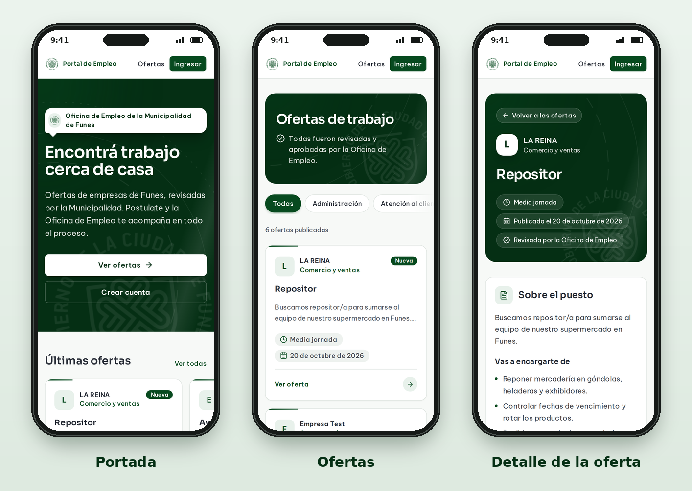
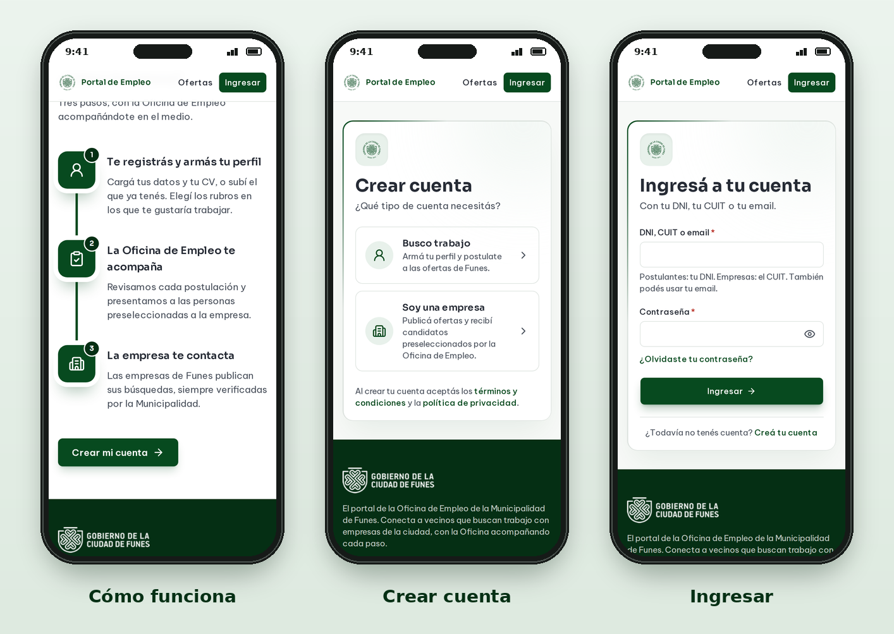
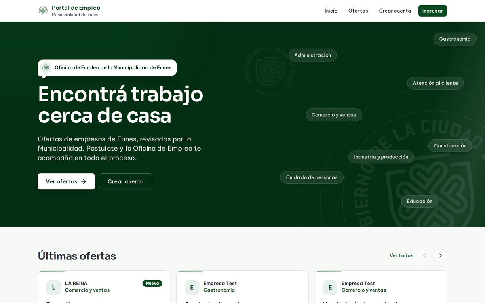
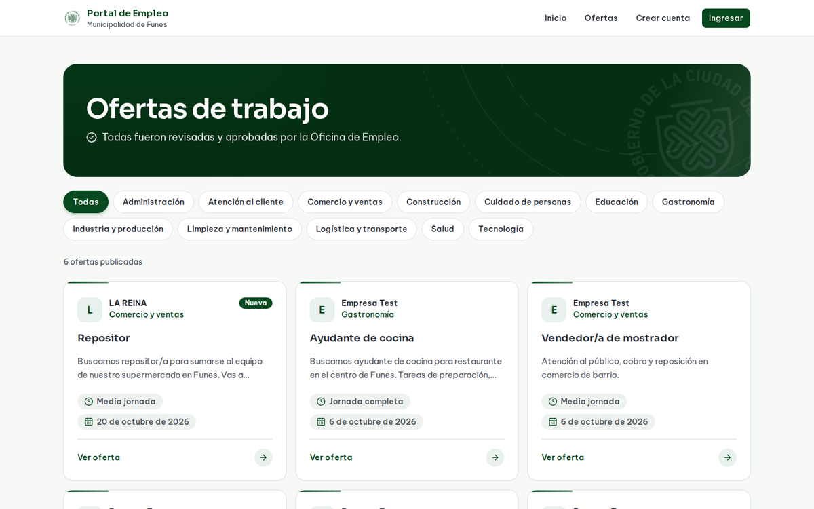
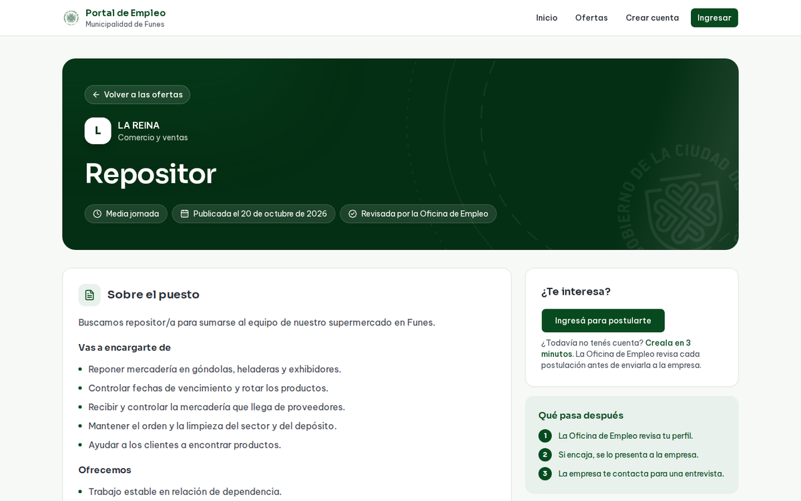
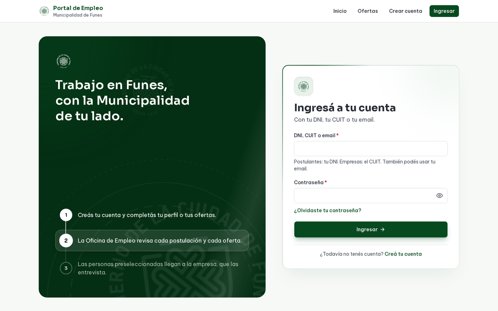

<p align="center">
  
</p>

<p align="center">
  <a href="https://portal-empleo-funes.vercel.app"></a>
</p>

<p align="center">
  
  
  
  
  
  
  
</p>

<p align="center">
  <a href="#-qué-es">Qué es</a> ·
  <a href="#-cómo-funciona">Cómo funciona</a> ·
  <a href="#-así-se-ve">Así se ve</a> ·
  <a href="#-qué-puede-hacer-cada-uno">Qué puede hacer cada uno</a> ·
  <a href="#-avance">Avance</a> ·
  <a href="#-para-desarrolladores">Para desarrolladores</a> ·
  <a href="#-equipo">Equipo</a>
</p>

---

## 🌱 Qué es

Es el **portal de empleo de la Oficina de Empleo de la Municipalidad de Funes** (Santa Fe, Argentina), hecho en el programa **Funes Tech Lab**.

Junta en un solo lugar a **vecinos que buscan trabajo**, **empresas de la ciudad que buscan gente** y a la **Oficina de Empleo**, que acompaña cada paso.

<table>
  <tr>
    <th width="50%">😓 Antes</th>
    <th width="50%">😊 Con el portal</th>
  </tr>
  <tr>
    <td>Los CV llegaban en papel o por mail y se cargaban <b>a mano en Excel</b>.</td>
    <td>Cada vecino arma su CV <b>desde el celular</b>, o sube el que ya tiene (PDF, Word o una foto).</td>
  </tr>
  <tr>
    <td>Costaba encontrar perfiles por rubro.</td>
    <td>Cada persona elige <b>sus rubros</b> y la Oficina filtra en segundos.</td>
  </tr>
  <tr>
    <td>Nadie sabía en qué estaba su postulación.</td>
    <td>Cada postulante ve <b>en qué etapa está</b>, en palabras simples.</td>
  </tr>
  <tr>
    <td>No había forma simple de medir resultados.</td>
    <td>Indicadores de contrataciones, rechazos y derivaciones a cursos <i>(en camino)</i>.</td>
  </tr>
</table>

> [!IMPORTANT]
> **La regla de oro:** el postulante y la empresa **nunca se comunican directo** dentro del portal. Todo pasa por la Oficina de Empleo, que revisa, preselecciona y acompaña.

---

## 🔄 Cómo funciona

<p align="center">
  
</p>

### El camino de una postulación

<p align="center">
  
</p>

### El camino de una oferta

<p align="center">
  
</p>

---

## 📸 Así se ve

<p align="center">
  
</p>

<p align="center">
  
</p>
<p align="center">
  
  <br><sub>📱 Pensado primero para el celular: la mayoría de los vecinos lo usa desde el teléfono.</sub>
</p>

<details>
<summary><b>🖥️ Ver más capturas en la compu</b></summary>

<br>

<p align="center"><br><b>Portada</b>: rubros flotando y últimas ofertas en carrusel</p>
<p align="center"><br><b>Ofertas</b>: todas revisadas por la Oficina</p>
<p align="center"><br><b>Detalle</b>: tareas, requisitos y compartir por WhatsApp</p>
<p align="center"><br><b>Ingresar</b>: con DNI, CUIT o email</p>

</details>

---

## 🙋 Qué puede hacer cada uno

### 👤 Vecino que busca trabajo
- ✅ Crear su cuenta con DNI en 3 pasos
- ✅ Armar el CV en el portal **o** subir el suyo (PDF, Word o foto)
- ✅ Elegir varios rubros
- ✅ Subir el comprobante de domicilio (vecinos de Funes)
- ✅ Postularse con un toque y ver en qué etapa está cada postulación
- ✅ Foto de perfil, que puede acomodar dentro del marco

### 🏢 Empresa
- ✅ Registrarse con CUIT (queda en revisión hasta que la Oficina la verifica)
- ✅ Cargar ofertas como borrador y enviarlas a revisión
- ✅ Ver el motivo si una oferta no se aprueba, y usarla como base para corregirla
- ✅ Recibir a los candidatos que preselecciona la Oficina
- ✅ Marcar a quién entrevistar o contratar y confirmar todo junto
- ✅ Editar sus datos, subir su logo (se ve en sus ofertas) y la constancia de ARCA

### 🏛️ Oficina de Empleo
- ✅ Bandeja: lo que espera revisión (empresas, ofertas, postulaciones, domicilios), con la antigüedad de lo más viejo
- 🔜 Aprobar empresas y ofertas, y verificar domicilios
- 🔜 Preseleccionar postulantes (vecinos de Funes primero)
- 🔜 Buscar perfiles por rubro, nombre o localidad
- 🔜 Ver indicadores con reporte semanal en PDF y Excel, y recomendar materiales para prepararse
- 🔜 Dar de alta otros Admins

> [!NOTE]
> El área de la Oficina se construye en la **Fase 6**. El plan completo está en [`docs/research/admin.md`](docs/research/admin.md).

### 📜 Las reglas que siempre se cumplen

| | Regla |
|:-:|---|
| 🤝 | **La Oficina siempre está en el medio**: la empresa solo ve a quienes la Oficina preseleccionó. |
| ✅ | **Nada se publica sin aprobación**: una oferta se ve en el portal solo si la Oficina la aprobó. |
| ⏳ | **Las empresas nuevas empiezan en revisión** y no pueden publicar hasta que la Oficina las verifica. |
| 🏡 | **Prioridad para vecinos de Funes**: el portal está abierto a todos, pero los de Funes van primero. |
| 🗂️ | **Varios rubros por persona** y **CV flexible**: armado en el portal o subido como archivo. |
| 🚫 | **Nadie se postula dos veces** a la misma oferta. |
| 💬 | **Todo rechazo tiene un motivo** (cupo completo o no seleccionado), y quien no queda puede ir a un curso. |

> Estas reglas no son solo de pantalla: las controla la **base de datos** (políticas RLS y triggers), así que no se pueden saltear.

### 🔒 Datos personales cuidados

- Las empresas **nunca** ven DNI, dirección, foto ni comprobante de domicilio. El teléfono y el email los ven recién cuando eligen entrevistar.
- Los archivos (CV, comprobantes, constancias) son **privados** y se abren con enlaces que vencen en minutos.
- [Política de privacidad](https://portal-empleo-funes.vercel.app/privacidad) según la Ley 25.326 y [términos y condiciones](https://portal-empleo-funes.vercel.app/terminos) *(versión preliminar, a revisar por la Municipalidad)*.

---

## 🚀 Avance

| Fase | | Estado |
|------|---|--------|
| 0 · Base del proyecto | 🟩🟩🟩🟩🟩 | ✅ Terminada |
| 1 · Base de datos segura | 🟩🟩🟩🟩🟩 | ✅ Terminada |
| 2 · Portal público | 🟩🟩🟩🟩🟩 | ✅ Terminada |
| 3 · Cuentas e ingreso | 🟩🟩🟩🟩🟩 | ✅ Terminada |
| 4 · Postulante | 🟩🟩🟩🟩🟩 | ✅ Terminada |
| 5 · Empresa | 🟩🟩🟩🟩🟩 | ✅ Terminada, con las correcciones del tutor |
| 6 · Oficina de Empleo (Admin) | 🟩⬜⬜⬜⬜ | ⏳ En curso ([plan](docs/research/admin.md)) |
| 7 · Calidad y entrega | 🟨⬜⬜⬜⬜ | ⏳ En parte (seguridad) |

Detalle tarea por tarea en [`docs/ROADMAP.md`](docs/ROADMAP.md).

---

## 🛠️ Para desarrolladores

<details>
<summary><b>⚡ Cómo correrlo en tu compu</b></summary>

<br>

**Necesitás:** Node.js 20 o superior, Git y acceso al proyecto de Supabase (pedilo al equipo).

```bash
# 1. Clonar el repo
git clone https://github.com/KevinKener/portal-empleo-funes.git
cd portal-empleo-funes

# 2. Instalar dependencias
npm install

# 3. Configurar variables de entorno
cp .env.example .env.local
# completar .env.local con los datos del proyecto de Supabase

# 4. Levantar el servidor de desarrollo
npm run dev
```

Abrí [http://localhost:3000](http://localhost:3000).

```bash
npm run dev      # desarrollo con recarga automática
npm run build    # build de producción (correrlo antes de dar algo por terminado)
npm run start    # correr el build
npm run lint     # revisar el código con ESLint
```

</details>

<details>
<summary><b>🔑 Variables de entorno</b></summary>

<br>

| Variable | Dónde se usa | Descripción |
|----------|-------------|-------------|
| `NEXT_PUBLIC_SUPABASE_URL` | Cliente y servidor | URL del proyecto de Supabase |
| `NEXT_PUBLIC_SUPABASE_PUBLISHABLE_KEY` | Cliente y servidor | Clave pública (publishable) de Supabase |
| `SUPABASE_SECRET_KEY` | **Solo servidor** (`src/lib/supabase/admin.ts`) | Clave secreta (*Project Settings → API Keys → Secret keys*). Saltea RLS: se usa solo para chequeos que un visitante sin sesión no puede hacer (ej. "¿este DNI ya tiene cuenta?"). Nunca con prefijo `NEXT_PUBLIC_` |

> [!WARNING]
> `.env.local` **nunca** se sube al repo. Si agregás una variable nueva, sumala a `.env.example` (sin valor) y a esta tabla.

</details>

<details>
<summary><b>☁️ Deploy en Vercel</b></summary>

<br>

El proyecto está conectado a Vercel con la integración de GitHub: cada push a `main` se publica en https://portal-empleo-funes.vercel.app y cada PR genera una URL de preview. Las variables de la tabla de arriba están cargadas en Vercel (Production y Preview); si agregás una nueva, cargala también ahí y hacé **Redeploy**. No conectes la integración "Supabase" de Vercel: la base ya está vinculada con esas variables.

</details>

<details>
<summary><b>🗄️ Base de datos y migraciones</b></summary>

<br>

El esquema vive en `supabase/migrations/` y los datos de demo en `supabase/seed.sql`. Usamos el CLI de Supabase con `npx` (no hace falta instalarlo):

```bash
npx supabase login                          # una sola vez, abre el navegador
npx supabase link --project-ref <ref>       # <ref> está en la URL del proyecto en Supabase
npx supabase db push --include-seed         # aplica migraciones pendientes + seed
npx supabase gen types typescript --linked --schema public > src/types/database.ts  # regenera los tipos
```

- Nunca cambiar tablas desde el dashboard sin crear la migración correspondiente.
- Después de cada migración, regenerar `src/types/database.ts` (no se edita a mano).
- Los estados y sus transiciones se consultan en `src/lib/estados.ts` (`puedeCambiarEstado`, `siguientesEstados`); no escribir estados sueltos en el código.
- **Cuenta Admin inicial:** crearla en *Authentication → Users → Add user* (sin metadata) y después, en el *SQL Editor*:
  `insert into public.perfiles (id, rol) values ('<id del usuario>', 'admin');`
  Los demás Admins se crean desde la app (regla 7).
- **Autenticación (configurada en el dashboard, no en migraciones):** SMTP de Gmail (`empleofunes.demo@gmail.com`), *Confirm email* activado, contraseña mínima de 8 caracteres. Las plantillas de mail viven en `supabase/templates/` (`confirmar-cuenta.html` → *Confirm sign up*, `recuperar-contrasena.html` → *Reset password*) y se pegan a mano en *Authentication → Emails → Templates* (el asunto está en el comentario de cada archivo). `supabase/config.toml` refleja la misma configuración para desarrollo local.
- Ojo: `postulaciones.notas_admin` es solo para Admins. Al consultar `postulaciones` hay que listar las columnas (`select('*')` da error de permisos); los Admins usan la vista `postulaciones_admin`.

</details>

<details>
<summary><b>🧱 Stack</b></summary>

<br>

| Capa | Tecnología |
|------|-----------|
| Framework | [Next.js 16](https://nextjs.org/) (App Router) + React 19 |
| Lenguaje | TypeScript estricto |
| Estilos | Tailwind CSS v4 + [shadcn/ui](https://ui.shadcn.com/) (Base UI), tokens de diseño en `src/app/globals.css` |
| Base de datos / Auth / Storage | [Supabase](https://supabase.com/) (PostgreSQL con RLS) |
| Emails | Gmail SMTP (auth hoy; notificaciones de estado en la Fase 6) |
| Deploy | Vercel |

La identidad visual (verde `#074A1F`, tipografías Sora y Be Vietnam Pro, escudo y logo en `public/marca/`) es la de [funes.gob.ar](https://funes.gob.ar/).

</details>

<details>
<summary><b>📂 Estructura del código</b></summary>

<br>

```
src/
├── app/          # Rutas (cada carpeta con page.tsx es una URL) y API (route.ts)
├── components/   # ui/ (shadcn) + componentes propios por dominio
├── hooks/        # Custom hooks de cliente
├── lib/          # Supabase, validaciones, estados y utilidades
└── types/        # Tipos generados desde la base
supabase/         # Migraciones y datos de prueba
docs/             # Roadmap, guía de Next.js, research y material del README
```

Las páginas públicas viven en el grupo `src/app/(publico)/`, que comparte encabezado y pie. Las áreas privadas (`/postulante`, `/empresa`, `/admin`) están protegidas en dos niveles: `src/proxy.ts` manda a `/ingresar` a quien no tiene sesión, y el `layout.tsx` de cada área verifica el rol; los datos los sigue protegiendo RLS en la base.

</details>

<details>
<summary><b>🗺️ Rutas</b></summary>

<br>

| URL | Descripción |
|-----|-------------|
| `/` | Portada: presentación del portal, últimas ofertas en carrusel y cómo funciona |
| `/ofertas` | Listado de ofertas publicadas, con filtro por categoría (`?categoria=`), orden (`?orden=recientes\|urgentes\|solicitadas`) y paginación (`?pagina=`); etiquetas Urgente, Muy solicitada, Pocos postulantes y Nueva |
| `/ofertas/[id]` | Detalle de una oferta publicada (404 si no existe o no está publicada), con compartir por WhatsApp |
| `/api/ofertas` · `/api/ofertas/[id]` | API pública de ofertas publicadas (JSON) |
| `/registro` | Crear cuenta: elegir entre postulante y empresa |
| `/registro/postulante` · `/registro/empresa` | Formularios de registro por pasos |
| `/registro/verificar` | Confirmar el email con el código de 6 números |
| `/ingresar` | Ingresar con DNI, CUIT o email + contraseña |
| `/recuperar` · `/recuperar/codigo` | Recuperar la contraseña con un código por email |
| `/terminos` · `/privacidad` | Términos y condiciones y política de privacidad (Ley 25.326), versión preliminar a revisar por la Municipalidad |
| `/postulante` | "Mi panel": próximo paso, mis postulaciones y ofertas de mis rubros (requiere rol postulante) |
| `/postulante/perfil` | "Mi perfil": foto (con encuadre) y lista de tareas con datos, rubros, CV y domicilio |
| `/postulante/datos` · `/postulante/rubros` | Editar datos personales y elegir rubros |
| `/postulante/cv` | Armar el CV (sobre vos, experiencia, estudios) o subirlo en PDF, Word o foto |
| `/postulante/domicilio` | Subir el comprobante de domicilio (solo vecinos de Funes) |
| `/postulante/postulaciones` | Mis postulaciones, con el estado de cada una |
| `/empresa` | "Mi panel" de la empresa: aviso mientras está en revisión, próximo paso, resumen de ofertas, embudo de candidatos y búsquedas activas (requiere rol empresa) |
| `/empresa/datos` | Mi empresa: logo (opcional, se ve en las ofertas; si no hay, la inicial), editar nombre comercial, teléfono y dirección (la razón social solo hasta que la Oficina verifica la empresa) y subir la constancia de ARCA (opcional) |
| `/empresa/ofertas` | Mis ofertas: borradores, en revisión, publicadas, rechazadas (con motivo) y cerradas |
| `/empresa/ofertas/nueva` · `/empresa/ofertas/[id]` · `/empresa/ofertas/[id]/editar` | Cargar una oferta como borrador, ver su estado (enviar a revisión, volver a borrador, cerrar, usar como base) y editarla mientras es borrador |
| `/empresa/ofertas/[id]/candidatos` | Candidatos preseleccionados por la Oficina: CV, borrador entrevistar/contratar/descartar y "Confirmar selección"; teléfono y email solo desde la entrevista |
| `/admin` | Bandeja de la Oficina de Empleo: colas de trabajo con su antigüedad (requiere rol admin) |
| `/admin/empresas`, `/admin/ofertas`, `/admin/postulantes`, `/admin/indicadores` | Secciones de la Oficina (por ahora avisan que están en camino) |

</details>

<details>
<summary><b>🤝 Cómo trabajamos</b></summary>

<br>

- **Ramas:** `main` siempre estable. Una rama por tarea: `feature/…`, `fix/…`, `docs/…`. Sin ramas apiladas: cada PR sale de `main`.
- **Commits:** en español con [Conventional Commits](https://www.conventionalcommits.org/es/) → `feat: agrega listado de ofertas`.
- **Integración:** Pull Request revisado por el compañero antes de mergear (*Create a merge commit* y después *Delete branch*).
- **Convenciones de código y reglas de negocio:** [`AGENTS.md`](AGENTS.md).
- **Trabajo con Claude Code:** [`CLAUDE.md`](CLAUDE.md).

</details>

<details>
<summary><b>📚 Documentación</b></summary>

<br>

| Documento | Para qué |
|-----------|----------|
| [`docs/ROADMAP.md`](docs/ROADMAP.md) | Fases, tareas y estado actual |
| [`docs/guia-nextjs.md`](docs/guia-nextjs.md) | Guía práctica de Next.js 16 para el equipo (rutas, componentes, API, Git) |
| [`AGENTS.md`](AGENTS.md) | Reglas de negocio, seguridad y convenciones (en inglés, para agentes de IA) |
| [`docs/research/`](docs/research/) | Investigaciones: UX del postulante, panel, notificaciones por email, mejoras y el plan del Admin |

</details>

---

## 👥 Equipo

<table>
  <tr>
    <td align="center" width="50%">
      <a href="https://github.com/Rpellizz1"><br><b>Maximo Reyes Pellizzer</b></a><br><sub>@Rpellizz1</sub>
    </td>
    <td align="center" width="50%">
      <a href="https://github.com/KevinKener"><br><b>Kevin Kener</b></a><br><sub>@KevinKener</sub>
    </td>
  </tr>
</table>

<p align="center">
  Tutor: <b>Elías Gallay</b> · Programa <b>Funes Tech Lab</b> · Municipalidad de Funes, Santa Fe 🇦🇷
</p>
